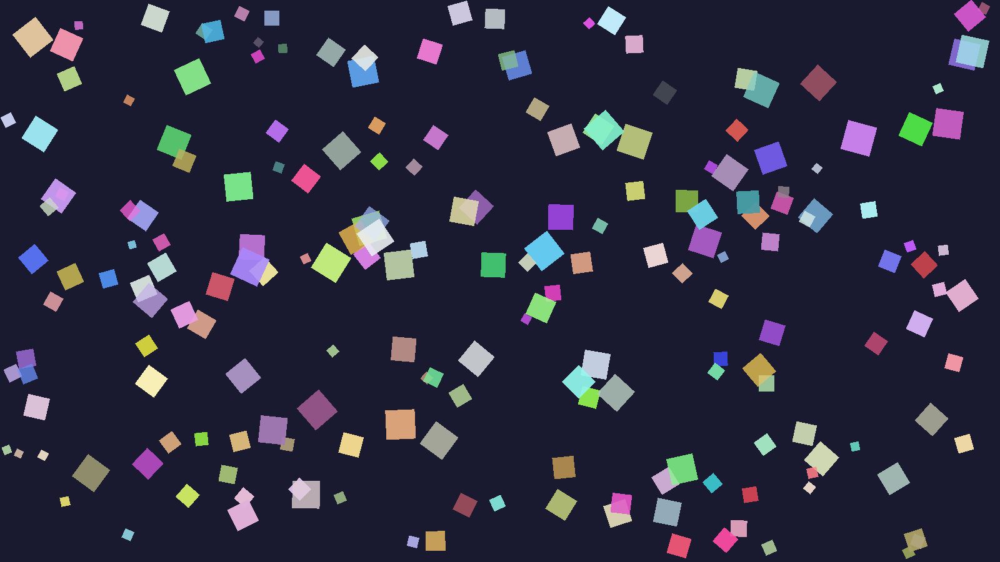

# Aedan's Playground

A C++20 / Vulkan engine being built to host Erebus Cradle. The plan is in
[`ROADMAP.md`](ROADMAP.md); where the last session stopped is in
[`HANDOFF.md`](HANDOFF.md).

**Current state:** a window, a main loop with a `std::chrono` frame clock, a
Vulkan renderer, and an entity component system (ECS). The demo spawns 200
entities with Transform, Velocity and Sprite components; systems move them,
bounce them off the window edges, and hand them to the renderer, which draws
each as a rotated, alpha-blended square.



*Captured from the running app on Mesa's software Vulkan driver. The
earlier milestone, one hardcoded triangle, is in `docs/first-triangle.png`.*

## Layout

| Folder | Library | Contents |
|---|---|---|
| `core/` | `playground_core` | `Result`, `Log`, `Assert`, `FrameClock` |
| `platform/` | `playground_platform` | `Platform` (GLFW lifetime, Ctrl+C), `Window` |
| `gpu/` | `playground_gpu` | Vulkan: `Instance`, `Surface`, `selectPhysicalDevice`, `Device`, `Context`, `Swapchain`, `DeviceHandle` |
| `ecs/` | `playground_ecs` | `Entity`, `ComponentPool`, `World` (create, destroy, add, get, `each<...>`) |
| `render/` | `playground_render` | `Renderer` (interface), `FrameData`, the Vulkan renderer, the shaders |
| `engine/` | `playground_engine` | `Application` (main loop), components (`Transform`, `Velocity`, `Sprite`), systems |
| `app/` | `playground_app` | `main.cpp` |
| `tests/` | | doctest suites for core, ECS, application, GPU and renderer |
| `third_party/` | | vendored `tl::expected` |

Each layer may include only the layers below it. Vulkan types stop at the
render layer: its public headers have none, so the engine and the game build
without Vulkan headers.

## Vulkan bring-up, in order

`gpu::Context::create()` runs four steps; each logs what it found, and a
failure says which step failed and why.

| Step | File | What it does |
|---|---|---|
| 1. Instance | `gpu/src/Instance.cpp` | Checks the loader supports Vulkan 1.3 and every needed extension; turns on the validation layer in debug builds and routes its messages into the log |
| 2. Surface | `gpu/src/Surface.cpp` | Vulkan's handle on the window (needed to ask which GPU can present to it) |
| 3. Physical device | `gpu/src/PhysicalDevice.cpp` | Logs every GPU, rejects each one that lacks something (with every reason), scores the rest, picks the best |
| 4. Logical device | `gpu/src/Device.cpp` | Enables exactly the features step 3 checked, creates the device, fetches the graphics (and present) queue |

The requirements both step 3 and step 4 use live in one place,
`gpu/src/Requirements.h`.

## The ECS

An entity is just an ID. Data lives in components, one packed array per
component type, and behaviour lives in systems: plain functions that run over
every entity with the components they need.

```cpp
ecs::World world;
ecs::Entity ship = world.create();
world.add<engine::Transform>(ship, engine::Transform{.position = {0, 0}});
world.add<engine::Velocity>(ship, engine::Velocity{.linear = {40, 0}});

engine::movementSystem(world, step.deltaSeconds);   // every Transform + Velocity
world.flush();                       // apply destroys queued during the systems
```

- `world.each<A, B>(fn)` walks the smallest of the pools and looks the rest
  up, calling `fn(entity, a, b)`.
- `destroy()` is deferred to `flush()`, so a system can destroy what it is
  walking. `add()` and `remove()` during `each()` are refused (debug assert).
- Handles carry a generation: after an entity is destroyed and its slot
  reused, old handles see nothing.
- Speed (release build): `movementSystem` over 100,000 entities takes about
  0.46 ms.

## The frame: fixed simulation steps, smooth drawing

The simulation runs in fixed steps of exactly 1/120 s, so it behaves the same
at any frame rate (a test checks that 30 fps and 144 fps give bit-identical
positions). Each frame, `Application::run`:

1. adds the frame's real duration (clamped to 0.25 s) to an accumulator and
   runs as many fixed steps as it holds: `setFixedUpdate`, 0..n times
   (`core/FixedStep.h`). At most 8 steps run per frame; if the game cannot
   keep up, it slows down briefly rather than freezing;
2. runs `setUpdate` once, with the real frame time (the FPS counter);
3. runs `setExtract` with `alpha`, the leftover fraction of a step in
   [0, 1): `engine::extractSprites` draws each sprite `alpha` of the way from
   its previous position to its current one, so motion is smooth at any
   display rate;
4. renders that list. The renderer never touches the ECS.

In each fixed step the demo runs `snapshotTransforms` (previous = current)
first, then movement and bounce. A newly spawned entity has no previous
state yet and is drawn where it is, so it never streaks in from the origin;
`Transform::teleport()` moves an entity without blending across the jump.

## Drawing a frame

`render/src/VulkanRenderer.cpp`, once per frame:

1. **Wait** for the GPU to finish the frame that last used this slot (two
   frames in flight).
2. **Acquire** a swapchain image to draw into.
3. **Record:** move the image into the drawing layout, clear it, bind the
   sprite pipeline, then per sprite push its 48 bytes of data (position,
   size, rotation, colour) and `vkCmdDraw(6 vertices)`, then move the image
   into the present layout.
4. **Submit** to the graphics queue.
5. **Present** the image to the window.

The quad's corners are in `render/shaders/sprite.vert`; no vertex buffer yet.
World units are pixels, with (0, 0) at the centre of the window and +y up. The shaders are compiled by `glslc` during the build and
embedded in the executable (see `cmake/Shaders.cmake`), so there are no shader
files to ship. When the window is resized, or present reports the swapchain is
out of date, the swapchain is rebuilt at the new size.

## Getting it running on Windows

1. **Visual Studio 2022** with the "Desktop development with C++" workload.
2. **The Vulkan SDK** from <https://vulkan.lunarg.com/sdk/home> (Windows
   installer, default options). It provides the Vulkan headers and loader
   library, the validation layer, `glslc` and `vulkaninfo`, and sets the
   `VULKAN_SDK` environment variable that CMake uses to find it. Restart your
   terminal afterwards so the variable is visible.
3. **vcpkg**, if you do not have it:

   ```bash
   git clone https://github.com/microsoft/vcpkg C:/vcpkg
   ```

   ```bash
   C:/vcpkg/bootstrap-vcpkg.bat
   ```

   Then set the environment variable `VCPKG_ROOT` to `C:/vcpkg` and restart
   the terminal.
4. **Check your GPU driver supports Vulkan 1.3:** run `vulkaninfo --summary`
   (it came with the SDK) and look for `apiVersion = 1.3.x` or higher under
   your GPU. If it says 1.2 or lower, update the GPU driver.
5. **Build and run**, from the `aedans-playground` folder in a "Developer
   PowerShell for VS 2022":

   ```bash
   cmake --preset windows
   ```

   ```bash
   cmake --build --preset windows-debug
   ```

   ```bash
   ./build/windows/app/Debug/playground_app.exe
   ```

   The first configure takes a while: vcpkg builds GLFW, spdlog and doctest.
6. **Run the tests:**

   ```bash
   ctest --preset windows-debug
   ```

The Windows presets have not been run yet. If MSVC reports warnings that GCC
and Clang did not, they stop the build (warnings are errors); add
`-DPLAYGROUND_WARNINGS_AS_ERRORS=OFF` to the configure command to get past
them, and report them so they can be fixed.

## Getting it running on Linux

Ubuntu 24.04 package names. The Mesa driver line gives a software Vulkan
device for machines without a GPU (CI, cloud containers); with a real GPU,
its vendor's driver is what gets used.

```bash
sudo apt-get install -y cmake ninja-build g++ libglfw3-dev libspdlog-dev doctest-dev libvulkan-dev vulkan-validationlayers vulkan-tools mesa-vulkan-drivers xvfb
```

```bash
cmake --preset debug
```

```bash
cmake --build --preset debug
```

```bash
./build/debug/app/playground_app
```

```bash
ctest --preset debug
```

Without a display, the window and GPU tests are reported as skipped. To run
them headless, wrap the command in a virtual display:

```bash
xvfb-run -a ctest --preset debug
```

Other presets: `release`, and `asan` (AddressSanitizer + UBSan).

## What a good start looks like

The log goes to the console and to `playground.log` next to where you ran it.
Lines are written to the file as they happen (every line in debug builds,
info and above in release), so `tail -f playground.log` is live.
On this project's test machine (software Vulkan driver), start-up logs:

```
[gpu     ] creating Vulkan instance (validation requested)
[gpu     ] Vulkan loader supports version 1.3.275
[gpu     ] Vulkan instance created: API 1.3.0, validation ON
[gpu     ]   layers: VK_LAYER_KHRONOS_validation
[gpu     ]   extensions: VK_KHR_surface, VK_KHR_xcb_surface, VK_EXT_debug_utils
[gpu     ] window surface created (1600x900 pixels)
[gpu     ] found 1 Vulkan device(s):
[gpu     ]   #0 llvmpipe (LLVM 20.1.2, 256 bits) — CPU (software), Vulkan 1.4.318, driver llvmpipe Mesa 25.2.8
[gpu     ]      suitable, score 60 (graphics queue family 0, present queue family 0)
[gpu     ] selected llvmpipe (LLVM 20.1.2, 256 bits) (CPU (software))
[gpu     ] creating logical device on llvmpipe (LLVM 20.1.2, 256 bits)
[gpu     ] logical device created: extensions VK_KHR_swapchain; features dynamicRendering, ...
[gpu     ] graphics queue ready: family 0, also used for present
[gpu     ] GPU ready: llvmpipe (LLVM 20.1.2, 256 bits) with Vulkan 1.4.318
[gpu     ] swapchain created: 1600x900, 4 images, B8G8R8A8_SRGB, FIFO (vsync)
[render  ] sprite pipeline built for B8G8R8A8_SRGB
[render  ] Vulkan renderer ready: 2 frames in flight
[engine  ] renderer "vulkan" attached
```

followed by `[game    ] spawned 200 sprites (200 entities)`, and the window
shows the bouncing squares above on a very dark blue background.

On a desktop you will see your own GPU, `discrete GPU` or `integrated GPU`,
and on Windows `VK_KHR_win32_surface` instead of `VK_KHR_xcb_surface`. A
laptop with two GPUs lists both; the discrete one wins.

Closing the window shuts down in the reverse order — renderer (pipeline,
swapchain, device, surface, instance), window, GLFW — and ends with
`clean exit`.

## When it does not start

Every failure is one `critical` line naming the step and the reason.

| Message contains | Meaning | Fix |
|---|---|---|
| `GLFW could not initialise` | No display (remote session, container) | Run on a desktop, or under `xvfb-run -a` on Linux |
| `no Vulkan loader or driver was found` | No Vulkan driver installed | Install or update the GPU driver |
| `the Vulkan loader on this machine supports 1.2` | Driver too old | Update the GPU driver |
| `step 3 (choosing a GPU): no GPU meets the engine's requirements` | Every GPU lacks something; the message lists what, per GPU | Update the driver; if it still fails, the GPU is older than the engine's minimum (Vulkan 1.3 with descriptor indexing) |
| `validation was requested but VK_LAYER_KHRONOS_validation is not installed` (warning) | The program still runs, without validation | Install the Vulkan SDK (Windows) or `vulkan-validationlayers` (Linux) |
| Window opens but stays black or dark blue with no squares | The draw is not reaching the screen | Run with `--verbose` and send the log; check for `[gpu] [error]` lines |
| `N Vulkan validation error(s)` at exit, exit code 1 | A real bug: the engine used Vulkan incorrectly | Read the `[gpu] [error]` lines above it; each names the rule broken (`VUID-...`) |

## Options

| Option | Effect |
|---|---|
| `--frames N` | exit after N frames |
| `--sprites N` | how many bouncing squares the demo spawns (default 200) |
| `--verbose` | debug-level logging: frame-time statistics, Vulkan loader messages |
| `--log-file PATH` | where the log goes (default `playground.log`) |
| `--validation` / `--no-validation` | force Vulkan validation on or off (default: on in debug builds, off in release) |

Exit codes: 0 clean exit (window closed, Ctrl+C, or frame limit), 1 start-up
failure, runtime failure or any Vulkan validation error, 2 bad arguments.
