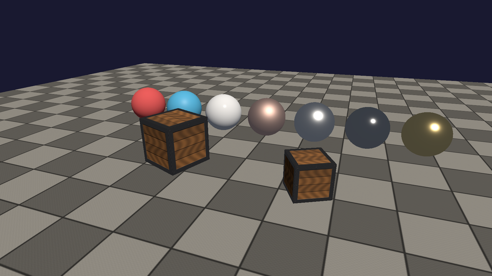

# Aedan's Playground

A C++20 / Vulkan engine being built to host Erebus Cradle. The plan is in
[`ROADMAP.md`](ROADMAP.md); where the last session stopped is in
[`HANDOFF.md`](HANDOFF.md).

**Current state:** a window, a fixed-timestep main loop, a Vulkan renderer
that draws textured, lit 3D meshes and 2D sprites, glTF 2.0 model loading,
an entity component system (ECS), keyboard/mouse input, an orbit/fly
camera, a job system (worker threads) and an asset manager that loads files
in the background.

The demo has two scenes. The default is **3D**: glTF models (a tiled floor,
textured crates, a row of spheres from rough plastic to polished gold) lit
by the sun, which you look around with the mouse. `--model PATH` shows any
glTF file instead. `--scene sprites` is the **2D** demo: steer a white
square among 25,000 bouncing ones, all drawn in one instanced draw call.



*The 3D scene, captured from the running app on Mesa's software Vulkan
driver. Earlier milestones: the first triangle (`docs/first-triangle.png`),
the first ECS sprites (`docs/ecs-sprites.png`), 25,000 instanced sprites
(`docs/instanced-25k.png`) and the tilted 2D view (`docs/perspective-3d.png`).*

**3D scene** (camera: `engine/CameraController.h`)

| Input | Orbit mode (the start) | Fly mode |
|---|---|---|
| Left-drag | spin around the target | |
| Right-drag | pan the target | look around |
| Wheel | zoom | change the fly speed |
| W A S D, arrows | tilt and spin | move where you look |
| Q / E | zoom out / in | down / up (also Ctrl / Space) |
| Shift | | 4x faster |
| Tab | switch to fly | switch to orbit |
| R | reset the view | reset the view |
| Escape | quit | quit |

**2D scene** (`--scene sprites`)

| Key | Action |
|---|---|
| W A S D, arrow keys | Move |
| Mouse | Aim |
| Space, left mouse button | Fire (towards the mouse) |
| Right mouse button | Remove the sprite under the mouse |
| C | Switch between the 2D (orthographic) and 3D (perspective) view |
| Escape | Quit |

## Layout

| Folder | Library | Contents |
|---|---|---|
| `core/` | `playground_core` | `Result`, `Log`, `Assert`, `FrameClock`, `FixedStep`, `JobSystem` |
| `platform/` | `playground_platform` | `Platform` (GLFW lifetime, Ctrl+C), `Window` |
| `gpu/` | `playground_gpu` | Vulkan: `Instance`, `Surface`, `selectPhysicalDevice`, `Device`, `Allocator` (VMA), `Buffer`, `Image` (+ `createTexture`, mipmaps), `Sampler`, `Context`, `Swapchain`, `DeviceHandle` |
| `ecs/` | `playground_ecs` | `Entity`, `ComponentPool`, `World` (create, destroy, add, get, `each<...>`) |
| `render/` | `playground_render` | `Renderer` (interface), `FrameData`, `Resources` (meshes, textures, materials: no Vulkan), the Vulkan renderer (`Mesh`, `ResourcePool`), the shaders |
| `engine/` | `playground_engine` | `Application` (main loop), `Camera`, `CameraController`, `AssetManager`, glTF (`decodeGltf`, `Model`, `gltfLoader`), components (`Transform`, `Velocity`, `Sprite`), systems, `pickSprite` |
| `app/` | `playground_app` | `main.cpp`, the scenes (`ModelScene`, `SpriteScene`), `assets/` (copied next to the executable) |
| `tests/` | | doctest suites for core, jobs, assets, glTF, ECS, input, camera, application, GPU, renderer and meshes; end-to-end keyboard and camera tests |
| `tools/` | | `make_demo_assets.py`: writes the demo's glTF models |
| `third_party/` | | vendored `tl::expected` and Vulkan Memory Allocator. tinygltf, nlohmann/json and stb_image come from system packages (Linux) or vcpkg (Windows) |

Each layer may include only the layers below it. Vulkan types stop at the
render layer: its public headers have none, so the engine and the game build
without Vulkan headers.

## Vulkan bring-up, in order

`gpu::Context::create()` runs four steps; each logs what it found, and a
failure says which step failed and why.

| Step | File | What it does |
|---|---|---|
| 1. Instance | `gpu/src/Instance.cpp` | Checks the loader supports Vulkan 1.3 and every needed extension; turns on the validation layer in debug builds and routes its messages into the log |
| 2. Surface | `gpu/src/Surface.cpp` | Vulkan's handle on the window (needed to ask which GPU can present to it) |
| 3. Physical device | `gpu/src/PhysicalDevice.cpp` | Logs every GPU, rejects each one that lacks something (with every reason), scores the rest, picks the best |
| 4. Logical device | `gpu/src/Device.cpp` | Enables exactly the features step 3 checked, creates the device, fetches the graphics (and present) queue |

The requirements both step 3 and step 4 use live in one place,
`gpu/src/Requirements.h`.

## The ECS

An entity is just an ID. Data lives in components, one packed array per
component type, and behaviour lives in systems: plain functions that run over
every entity with the components they need.

```cpp
ecs::World world;
ecs::Entity ship = world.create();
world.add<engine::Transform>(ship, engine::Transform{.position = {0, 0}});
world.add<engine::Velocity>(ship, engine::Velocity{.linear = {40, 0}});

engine::movementSystem(world, step.deltaSeconds);   // every Transform + Velocity
world.flush();                       // apply destroys queued during the systems
```

- `world.each<A, B>(fn)` walks the smallest of the pools and looks the rest
  up, calling `fn(entity, a, b)`.
- `destroy()` is deferred to `flush()`, so a system can destroy what it is
  walking. `add()` and `remove()` during `each()` are refused (debug assert).
- Handles carry a generation: after an entity is destroyed and its slot
  reused, old handles see nothing.
- Speed (release build): `movementSystem` over 100,000 entities takes about
  0.46 ms.

## The frame: fixed simulation steps, smooth drawing

The simulation runs in fixed steps of exactly 1/120 s, so it behaves the same
at any frame rate (a test checks that 30 fps and 144 fps give bit-identical
positions). Each frame, `Application::run`:

1. adds the frame's real duration (clamped to 0.25 s) to an accumulator and
   runs as many fixed steps as it holds: `setFixedUpdate`, 0..n times
   (`core/FixedStep.h`). At most 8 steps run per frame; if the game cannot
   keep up, it slows down briefly rather than freezing;
2. runs `setUpdate` once, with the real frame time (the FPS counter);
3. runs `setExtract` with `alpha`, the leftover fraction of a step in
   [0, 1): `engine::extractSprites` draws each sprite `alpha` of the way from
   its previous position to its current one, so motion is smooth at any
   display rate;
4. renders that list. The renderer never touches the ECS.

In each fixed step the demo runs `snapshotTransforms` (previous = current)
first, then movement and bounce. A newly spawned entity has no previous
state yet and is drawn where it is, so it never streaks in from the origin;
`Transform::teleport()` moves an entity without blending across the jump.

## Input

Three layers, in `platform/Input.h` and `engine/Actions.h`:

- **`InputCollector`** is fed by the window's GLFW callbacks and gives one
  snapshot per frame. Each key and mouse button has `down`, `pressed` and
  `released`; a tap inside one frame shows as pressed and released, never
  lost. **Losing focus** (Alt+Tab) releases everything held, so no key sticks.
- **`InputLatch`** hands input to the fixed steps: every step in a frame
  sees the same held keys, but each press reaches exactly **one** step. A
  slow frame running four steps fires once, not four times; a fast frame
  running none keeps the press for the next step.
- **`ActionMap`** maps keys to actions as data: `Move` (a 2D axis, never
  longer than 1, so diagonals are not faster) and `Fire`. Game code asks
  `actions.pressed(input, actions::kFire)`, never "is Space down".

The fixed update receives the latched input; the per-frame update receives
the frame's own snapshot.

## World bounds and the view

The playing area is a `WorldBounds` owned by the game (1600×900 world
units), and `bounceSystem` reads only that, never the window. Resizing
changes the view, not the game.

## Camera

`engine::Camera` (`engine/Camera.h`) looks from `position` at `target` and
projects one of two ways:

- **Orthographic** (the default 2D view): `orthoHalfExtent` is the world
  area that must be visible, fitted to the window without stretching
  (`render::fitView`), with bars where the shapes differ.
- **Perspective** (`glm::perspective`): a 3D view; farther things look
  smaller. Press **C** in the demo to see the playfield tilted in 3D.

Both are converted to **reverse-Z** (depth 1 at the near plane, 0 at the far
plane), which spreads floating-point depth precision evenly. Each frame the
game puts `camera.viewProjection(viewport)` in `FrameData`, and the renderer
copies it into a per-frame **uniform buffer** that the vertex shader reads
(descriptor set 0, binding 0).

`camera.screenToWorld(cursor, windowSize)` turns a mouse position into the
point on the gameplay plane under it, by casting a ray through the inverse
view-projection, so it works in both projections. The demo uses it to aim
bullets and, with `engine::pickSprite`, to remove the sprite you right-click.


## Drawing a frame

`render/src/VulkanRenderer.cpp`, once per frame:

1. **Wait** for the GPU to finish the frame that last used this slot (two
   frames in flight).
2. **Acquire** a swapchain image to draw into.
3. **Free** meshes and textures destroyed at least two frames ago.
4. **Write the frame's data** straight into this frame slot's buffers
   (host-visible, mapped once and kept mapped; they double when outgrown):
   the mesh draw list, the sprites (opaque first, then translucent ones
   sorted back to front), and the camera and lights in the uniform buffer.
5. **Record:** clear the image and the depth buffer, bind the frame's
   uniforms (set 0) and the texture array (set 1), draw every mesh (one
   indexed draw each), then **all** sprites with at most two instanced
   draws, `vkCmdDraw(6 vertices, N instances)`: opaque sprites with depth
   writes, then translucent ones without (they still depth-test). Then
   move the image into the present layout.
6. **Submit** to the graphics queue.
7. **Present** the image to the window.

The vertex shader (`render/shaders/sprite.vert`) picks its sprite with
`gl_InstanceIndex`, reads it through a buffer reference
(`GL_EXT_buffer_reference`: the storage buffer is found by its 64-bit GPU
address), and multiplies by the camera matrix from the uniform buffer. The
quad's corners are constants in the shader.

**Depth.** A `D32_SFLOAT` depth buffer (reverse-Z: cleared to 0, test
`GREATER_OR_EQUAL`), rebuilt with the swapchain. A sprite's `layer` is its
world z, so higher layers are in front whatever the draw order; equal
layers keep draw order. Translucent sprites follow the standard rule for
transparency: sorted back to front, depth tested but not written, so they
blend with what is behind them and many of them on one plane do not
z-fight in the 3D view.

**Frame capture.** `requestCapture()` / `takeCapture()` copy a rendered
frame back to the CPU as RGBA; the renderer tests use it to check actual
pixel colours (depth order, translucency, the camera). The shaders are compiled by `glslc` during the build and
embedded in the executable (see `cmake/Shaders.cmake`), so there are no shader
files to ship. When the window is resized, or present reports the swapchain is
out of date, the swapchain is rebuilt at the new size.

## 3D meshes, textures and materials

The renderer draws **meshes** before sprites, sharing the camera and depth
buffer. Everything above the render layer uses plain data
(`render/Resources.h`): `MeshData` (vertices with position, normal,
tangent and UV, plus 32-bit indices), `ImageData` (RGBA8), and **handles**
back from `Renderer::createMesh` / `createTexture`. Each frame the game
lists `MeshInstance`s (mesh, material, transform) in `FrameData`.

- **Meshes** (`render/src/Mesh.h`): vertex and index buffers in device-local
  memory, uploaded once through a staging buffer. Indices are checked
  first: one past the last vertex is an error, not a GPU fault.
- **Textures** (`gpu::createTexture`): staging copy, then the GPU builds the
  full **mip chain** with linear blits, moving each level through
  TRANSFER_DST → TRANSFER_SRC → SHADER_READ_ONLY. Base colour is stored as
  sRGB (so mips average in linear light), normal and metallic-roughness
  maps as plain data. One trilinear sampler with anisotropic filtering
  (when the GPU has it) serves every texture.
- **Bindless**: every texture sits in one big descriptor array (set 1,
  4,096 slots, update-after-bind); a material names its textures by slot.
  Slots 0 and 1 hold the defaults (white, flat normal) for textures a
  material lacks.
- **Draws**: per frame, one 176-byte entry per mesh instance (transform,
  normal matrix, material) in a storage buffer read by GPU address; one
  `vkCmdDrawIndexed` per instance with `firstInstance` = its entry.
  Double-sided materials use a second pipeline without culling.
- **Shading** (`render/shaders/mesh.frag`): glTF's metallic-roughness model,
  GGX/Smith/Schlick specular, normal mapping, one directional sun and a
  flat ambient term. No shadows or environment reflections yet, so metals
  look dark away from their highlight.
- **Destroying** a mesh or texture makes its handle stale at once; the
  memory is freed after every frame that might still use it has finished.

### glTF 2.0 models

`engine/Gltf.h` plugs into the asset manager:

```cpp
assets.registerType<engine::Model>(engine::gltfLoader(renderer));
auto helmet = assets.load<engine::Model>("models/helmet.glb");
// once ready, each frame:
if (const engine::Model* model = assets.get(helmet)) model->extract(transform, frame);
```

On a worker, `decodeGltf` reads `.gltf` or `.glb` (tinygltf), decodes PNG
and JPEG images to RGBA (stb_image), converts triangle primitives
(positions, normals, tangents, UVs, any glTF component type and stride),
makes flat normals and tangents when a file lacks them, and flattens the
node tree. On the main thread, `uploadModel` creates the meshes and
textures. A `Model` destroys them when unloaded, so `AssetManager::clear()`
runs before the renderer shuts down. Files with extensions we lack marked
as *required* (Draco, meshopt, KTX2) fail with a message naming them.
Skins, animation, morph targets, alpha blending and emissive are not read
yet (see `engine/Gltf.h`).

The demo's models are our own, generated by `tools/make_demo_assets.py`
(Python standard library only). Khronos's sample models (DamagedHelmet,
Avocado, BoxTextured, NormalTangentMirrorTest) were checked with
`--model` and render correctly, mirrored tangents included; they are not
in the repository.

## GPU memory

`gpu::Allocator` wraps the Vulkan Memory Allocator (VMA), owned by
`gpu::Context` and destroyed just before the device; it logs an error for any
buffer still alive at that point. `gpu::Buffer` is an RAII buffer of one of
three kinds:

| Kind | Use |
|---|---|
| `HostVisible` | written by the CPU every frame; mapped for its whole life (the sprite buffers) |
| `DeviceLocal` | the GPU's own memory; filled once through a staging copy (`createDeviceLocalBuffer`) |
| `HostReadback` | GPU results read by the CPU (tests, later screenshots) |

Speed, 25,000 sprites, release build, validation off, on the software
renderer in the cloud container (a CPU doing the GPU's work, so pixel filling
dominates): one draw per sprite took about 66 ms a frame; one instanced draw
takes about 38 ms, with the 120 Hz simulation keeping up. The 3D scene
(about 15,500 lit triangles plus the textured floor, 1600x900) takes about
30 ms. Not yet measured on a real GPU.

## Worker threads: the job system

`JobSystem` (`core/JobSystem.h`) is a pool of worker threads, by default one
fewer than the CPU has cores (at least one), sharing one queue. Three ways to
use it:

| Call | Use |
|---|---|
| `submit(fn)` | One background task; returns a `std::future` with its result (or its exception). |
| `run(fn, counter)` | Fire-and-forget; `counter.wait()` blocks until all jobs on that counter are done. |
| `parallelFor(count, batch, fn)` | Splits `0..count` into batches; `fn(begin, end)` runs on the workers and on the calling thread, and returns when all are done. The first exception is rethrown. |

Waiting never just sleeps while there is work: `JobCounter::wait()` and
`parallelFor` run queued jobs on the waiting thread, so a job that waits for
other jobs (nested `parallelFor`) cannot deadlock the pool, even with one
worker. Destroying the `JobSystem` finishes every queued job, then joins the
threads.

## Loading files: the asset manager

`engine::AssetManager` (`engine/Assets.h`) loads files without stopping the
game. Each asset type registers a loader with two halves:

- **decode**, on a worker thread: read the file and turn its bytes into
  CPU data (parse it, decompress it). The slow part.
- **finalize**, on the main thread inside `assets.update()`: make the
  finished asset, for example by uploading it to the GPU, since Vulkan
  objects belong to the main thread. `update(budget)` finalizes at most
  `budget` assets per frame (8 by default), so a burst of loads is spread
  over several frames.

`load<T>("path")` returns an `AssetHandle<T>` at once; `state(handle)` is
`Loading`, then `Ready` (`get(handle)` returns it) or `Failed` (`error(handle)`
says why, naming the file). Loading the same path twice returns the same
handle. `unload(handle)` frees an asset; if it was still loading, its result
is thrown away. Handles carry a generation, like ECS entities, so an old
handle never finds a newer asset that reused its slot.

Workers never touch the asset table: they hand results to the main thread
through one locked queue. Every other call is main-thread only, and debug
builds assert it. The renderer test `an asset is read on a worker and
uploaded to GPU memory on the main thread` loads a 64 KiB file into a
device-local buffer this way and reads it back.

The demo loads `app/assets/welcome.txt` at start-up and logs it once it is
ready (`[game    ] asset welcome.txt: Welcome to Aedan's Playground.`).

## Getting it running on Windows

1. **Visual Studio 2022** with the "Desktop development with C++" workload.
2. **The Vulkan SDK** from <https://vulkan.lunarg.com/sdk/home> (Windows
   installer, default options). It provides the Vulkan headers and loader
   library, the validation layer, `glslc` and `vulkaninfo`, and sets the
   `VULKAN_SDK` environment variable that CMake uses to find it. Restart your
   terminal afterwards so the variable is visible.
3. **vcpkg**, if you do not have it:

   ```bash
   git clone https://github.com/microsoft/vcpkg C:/vcpkg
   ```

   ```bash
   C:/vcpkg/bootstrap-vcpkg.bat
   ```

   Then set the environment variable `VCPKG_ROOT` to `C:/vcpkg` and restart
   the terminal.
4. **Check your GPU driver supports Vulkan 1.3:** run `vulkaninfo --summary`
   (it came with the SDK) and look for `apiVersion = 1.3.x` or higher under
   your GPU. If it says 1.2 or lower, update the GPU driver.
5. **Build and run**, from the `aedans-playground` folder in a "Developer
   PowerShell for VS 2022":

   ```bash
   cmake --preset windows
   ```

   ```bash
   cmake --build --preset windows-debug
   ```

   ```bash
   ./build/windows/app/Debug/playground_app.exe
   ```

   The first configure takes a while: vcpkg builds GLFW, spdlog and doctest.
6. **Run the tests:**

   ```bash
   ctest --preset windows-debug
   ```

The Windows presets have not been run yet. If MSVC reports warnings that GCC
and Clang did not, they stop the build (warnings are errors); add
`-DPLAYGROUND_WARNINGS_AS_ERRORS=OFF` to the configure command to get past
them, and report them so they can be fixed.

## Getting it running on Linux

Ubuntu 24.04 package names. The Mesa driver line gives a software Vulkan
device for machines without a GPU (CI, cloud containers); with a real GPU,
its vendor's driver is what gets used.

```bash
sudo apt-get install -y cmake ninja-build g++ libglfw3-dev libglm-dev libspdlog-dev doctest-dev libtinygltf-dev nlohmann-json3-dev libstb-dev libvulkan-dev vulkan-validationlayers vulkan-tools mesa-vulkan-drivers glslc xvfb xdotool
```

```bash
cmake --preset debug
```

```bash
cmake --build --preset debug
```

```bash
./build/debug/app/playground_app
```

```bash
ctest --preset debug
```

`xdotool` is only for `keyboard_e2e`, which sends real keystrokes to the game;
without it that test is skipped.

Without a display, the window and GPU tests are reported as skipped. To run
them headless, wrap the command in a virtual display:

```bash
xvfb-run -a ctest --preset debug
```

Other presets: `release`, `asan` (AddressSanitizer + UBSan), and `tsan`
(ThreadSanitizer, which finds data races; it runs only the tests labelled
`threads`, the job and asset suites):

```bash
cmake --preset tsan
cmake --build --preset tsan
ctest --preset tsan
```

## What a good start looks like

The log goes to the console and to `playground.log` next to where you ran it.
Lines are written to the file as they happen (every line in debug builds,
info and above in release), so `tail -f playground.log` is live.
On this project's test machine (software Vulkan driver), start-up logs:

```
[gpu     ] creating Vulkan instance (validation requested)
[gpu     ] Vulkan loader supports version 1.3.275
[gpu     ] Vulkan instance created: API 1.3.0, validation ON
[gpu     ]   layers: VK_LAYER_KHRONOS_validation
[gpu     ]   extensions: VK_KHR_surface, VK_KHR_xcb_surface, VK_EXT_debug_utils
[gpu     ] window surface created (1600x900 pixels)
[gpu     ] found 1 Vulkan device(s):
[gpu     ]   #0 llvmpipe (LLVM 20.1.2, 256 bits) — CPU (software), Vulkan 1.4.318, driver llvmpipe Mesa 25.2.8
[gpu     ]      suitable, score 60 (graphics queue family 0, present queue family 0)
[gpu     ] selected llvmpipe (LLVM 20.1.2, 256 bits) (CPU (software))
[gpu     ] creating logical device on llvmpipe (LLVM 20.1.2, 256 bits)
[gpu     ] logical device created: extensions VK_KHR_swapchain; features dynamicRendering, ...
[gpu     ] graphics queue ready: family 0, also used for present
[gpu     ] GPU ready: llvmpipe (LLVM 20.1.2, 256 bits) with Vulkan 1.4.318
[gpu     ] swapchain created: 1600x900, 4 images, B8G8R8A8_SRGB, FIFO (vsync)
[render  ] sprite pipeline built for B8G8R8A8_SRGB
[render  ] Vulkan renderer ready: 2 frames in flight
[engine  ] renderer "vulkan" attached
```

followed by `[game    ] 3D scene: 4 object(s) loading; ...`,
`[game    ] asset welcome.txt: Welcome to Aedan's Playground.`, one
`[engine  ] model "..." uploaded` and one `[game    ] ... ready` line per
model, and the window shows the scene in the screenshot above. (With
`--scene sprites`: `[game    ] spawned 25000 sprites and the player; ...`
and the bouncing squares.)
Before the GPU lines, `[core    ] job system: N worker thread(s)` gives the
number of worker threads (one fewer than your CPU's cores).

On a desktop you will see your own GPU, `discrete GPU` or `integrated GPU`,
and on Windows `VK_KHR_win32_surface` instead of `VK_KHR_xcb_surface`. A
laptop with two GPUs lists both; the discrete one wins.

Closing the window shuts down in the reverse order — renderer (pipeline,
swapchain, device, surface, instance), window, GLFW — and ends with
`clean exit`.

## When it does not start

Every failure is one `critical` line naming the step and the reason.

| Message contains | Meaning | Fix |
|---|---|---|
| `GLFW could not initialise` | No display (remote session, container) | Run on a desktop, or under `xvfb-run -a` on Linux |
| `no Vulkan loader or driver was found` | No Vulkan driver installed | Install or update the GPU driver |
| `the Vulkan loader on this machine supports 1.2` | Driver too old | Update the GPU driver |
| `step 3 (choosing a GPU): no GPU meets the engine's requirements` | Every GPU lacks something; the message lists what, per GPU | Update the driver; if it still fails, the GPU is older than the engine's minimum (Vulkan 1.3 with descriptor indexing) |
| `validation was requested but VK_LAYER_KHRONOS_validation is not installed` (warning) | The program still runs, without validation | Install the Vulkan SDK (Windows) or `vulkan-validationlayers` (Linux) |
| Window opens but stays black or dark blue with no squares | The draw is not reaching the screen | Run with `--verbose` and send the log; check for `[gpu] [error]` lines |
| `N Vulkan validation error(s)` at exit, exit code 1 | A real bug: the engine used Vulkan incorrectly | Read the `[gpu] [error]` lines above it; each names the rule broken (`VUID-...`) |

## Options

| Option | Effect |
|---|---|
| `--scene models` / `--scene sprites` | the 3D scene (default) or the 2D one |
| `--model PATH` | show this glTF 2.0 file (`.gltf` or `.glb`) in the 3D scene |
| `--frames N` | exit after N frames |
| `--sprites N` | how many bouncing squares the 2D scene spawns (default 25000; implies `--scene sprites`) |
| `--verbose` | debug-level logging: frame-time statistics, Vulkan loader messages |
| `--log-file PATH` | where the log goes (default `playground.log`) |
| `--validation` / `--no-validation` | force Vulkan validation on or off (default: on in debug builds, off in release) |

Exit codes: 0 clean exit (window closed, Ctrl+C, or frame limit), 1 start-up
failure, runtime failure or any Vulkan validation error, 2 bad arguments.
